# Object Detection with Stereo Depth Estimation</h1>

**Real-time object detection and stereo depth estimation using NVIDIA Jetson Orin Nano, TensorRT, DeepStream, CV-CUDA, and Python.**

A GPU-accelerated computer vision application that combines YOLO object detection with stereo camera geometry to estimate the distance of detected objects from a binocular camera setup.

The application provides an interactive web interface for configuring video sources, selecting inference modes, enabling stereo depth analysis, and visualizing detection results in real time.

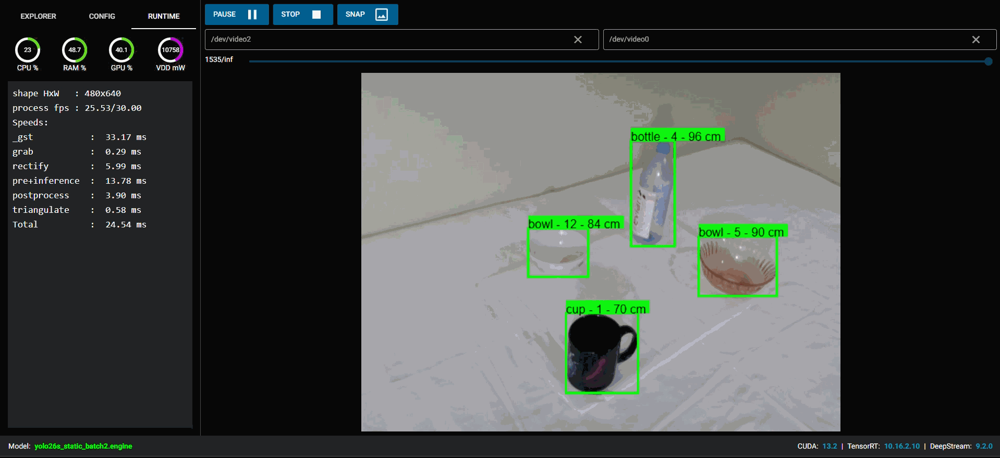


## Overview

This project explores the implementation of an end-to-end computer vision pipeline on an NVIDIA Jetson Orin Nano, integrating object detection, stereo image processing, and real-time visualization.

Two software-synchronized video streams are captured from a binocular webcamera setup and processed through a configurable pipeline. Depending on the selected mode, the application can perform:

- **Object detection:** Identify and classify objects in both camera streams using a YOLO model accelerated with TensorRT.
- **Object detection with depth estimation:** Rectify stereo images, detect corresponding objects, and estimate their distance using triangulation.

The web interface is built with **NiceGUI**, providing a web user interface to configure the pipeline and visualize results.

A primary design objective of this project is to **minimize CPU-GPU data transfers** by keeping image processing operations on the GPU wherever practical.

## Key Features

- Stereo video capture from two USB webcams or side-by-side (SBS) video files.
- GPU-based image processing using CUDA-backed PyTorch and CV-CUDA tensors.
- Object detection using TensorRT enabled YOLO end-to-end models.
- Two inference execution modes: sequential and optimized with overlapping GPU operations.
- Object correspondence between stereo views using ByteTrack multiple object tracking.
- Sparse stereo depth estimation using geometric triangulation.
- Web user interface for configuration and visualization with NiceGUI.
- WebRTC or Custom WebSocket streaming with synchronized image and detection metadata.

## Hardware Setup

The system runs on an [NVIDIA Jetson Orin Nano - Developer Kit](https://docs.nvidia.com/jetson/orin-nano-devkit/user-guide/latest/index.html), connected to two identical [USB webcams](https://emeet.com/products/webcam-c950?variant=42290847187115).

The webcams are mounted side by side on a flat base to form a binocular stereo camera arrangement.

## Software Stack

The following software platforms and tools were used.

| Component         | Version            |
|-------------------|--------------------|
| NVIDIA JetPack    | 7.2.1 (L4T 39.2.1) |
| Ubuntu            | 24.04              |
| CUDA              | 13.2.86            |
| TensorRT          | 10.16.2.10         |
| NVIDIA VPI        | 4.1.4.0            |
| NVIDIA DeepStream | 9.2.1              |
| Python            | 3.12.3             |

Besides DeepStream, all other tools are included with `Jetpack 7.2.1` and the `nvidia-jetpack` package.

### Main Libraries and Frameworks

- **NiceGUI:** Web application and interactive user interface.
- **DeepStream** UVC video capture, synchronization, and GStreamer pipeline integration.
- **PyTorch:** CUDA-backed tensor representation and data handling.
- **CV-CUDA:** GPU-accelerated image processing.
- **TensorRT:** Optimized YOLO inference for NVIDIA devices.
- **OpenCV:** General image processing.
- **ByteTrack:** Association of detected objects in binocular frames.
- **WebSocket / WebRTC:** Real-time streaming for visualization.

## Application Interface

The application provides a web interface organized into two main areas.

### Configuration Panel

The left panel contains tabbed sections to select video sources and vision models, set configuration and processing options, and view runtime data.

| | | |
| :---: | :---: | :---: |
| 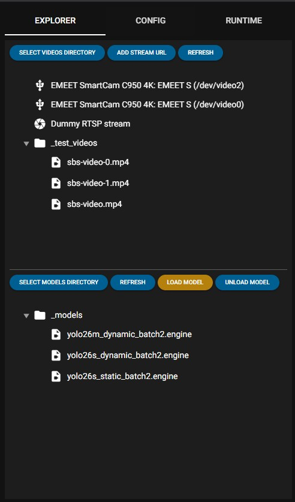 | 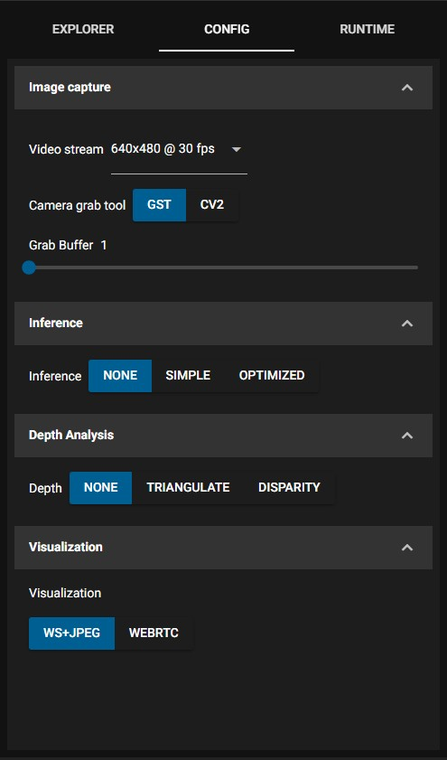 | 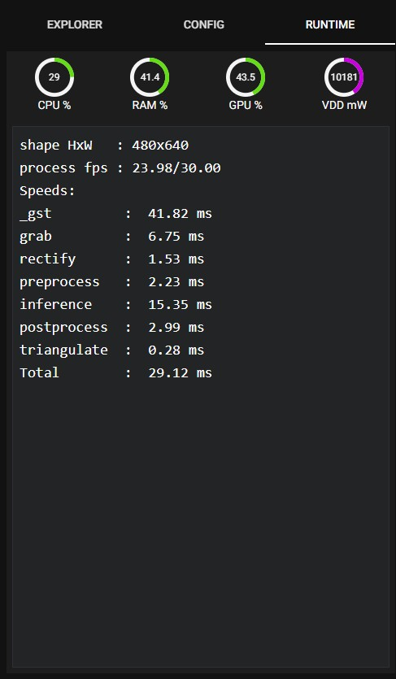 |
|explorer view | configuration view | runtime view|

Users can:

- Select the left and right video sources from available USB cameras or SBS video files.
- Load and unload YOLO object detection models.
- Select the webcam image size and frame rate.
- Select between sequential and optimized inference for object detection.
- Enable stereo triangulation for depth estimation.
- Configure the available processing and visualization options.
- Export benchmarks over a configurable sample size.

### Visualization Panel

The right panel displays the processed video streams and their associated results in real-time.

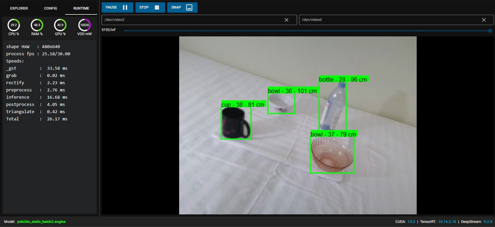

## Processing Pipeline

The application uses a modular processing pipeline, allowing different computer vision operations to be enabled depending on the selected mode.

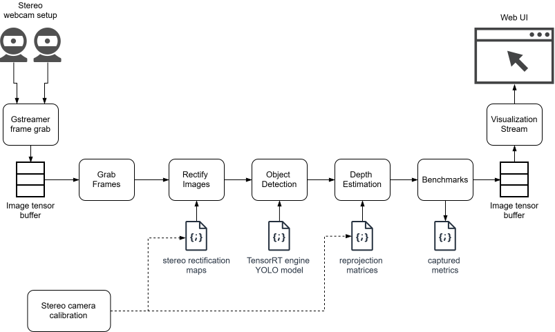

### Stage 1: Image Capture and Synchronization

Image capture is implemented using [NVIDIA DeepStream PyServiceMaker](https://docs.nvidia.com/deepstream/text/DS_service_maker_intro#3-python-pipeline-api), which provides a Python interface for constructing and managing a GStreamer-based processing pipeline.

The following is the GStreamer capture pipeline. It consumes frames from both webcams, ingests them into the GPU space as NvBufSurface surfaces, and synchronizes them: 

```
nvstreammux name=mux 
    width={width} height={height} 
    batch-size=2 batched-push-timeout={1e6 / fps} 
    live-source=true max-latency={1e9 / fps}
    sort-batch=true
! nvvideoconvert 
    copy-hw=GPU compute-hw=GPU nvbuf-memory-type=nvbuf-mem-surface-array 
! video/x-raw(memory:NVMM), format=RGB 
! appsink 
    name=app_sink emit-signals=true drop=true max-buffers=1 sync=false

v4l2src 
    device=/device/video0 do-timestamp=true io-mode=dmabuf 
! image/jpeg, width={width}, height={height}, framerate={fps}/1 
! nvv4l2decoder mjpeg=true 
! queue max-size-buffers=1 leaky=downstream 
! mux.sink_%u

v4l2src 
    device=/device/video1 do-timestamp=true io-mode=dmabuf 
! image/jpeg, width={width}, height={height}, framerate={fps}/1 
! nvv4l2decoder mjpeg=true 
! queue max-size-buffers=1 leaky=downstream 
! mux.sink_%u
```

Finally, a [BufferRetriever](https://github.com/NVIDIA/skills/blob/main/skills/deepstream-dev/references/buffer_apis.md) object is attached to the pipeline's appsink to  allow the consumption of the pipeline output images as CUDA-backed PyTorch tensors. Example:

```python
class FrameRetriever(BufferRetriever):
    ...
    def consume(self, buffer_retriever):
        tensor = buffer_retriever.extract(frame_meta.source_id).clone()
        image_tensor:torch.Tensor = torch.utils.dlpack.from_dlpack(tensor)
```


### Stage 2: Stereo Image Rectification

> **This stage is only required when performing stereo depth estimation.**

For stereo depth estimation, the captured images must be rectified to compensate for camera distortion and align their epipolar geometry, i-e., ensuring that any point in the left image maps to a point on the exact same row in the right image, reducing the stereo matching search space to a 1D horizontal path.

Rectification maps were generated beforehand using OpenCV calibration and stereo geometry functions. See the section on [Camera Calibration](#camera-calibration) for more info.

Image rectification is done using [CV-CUDA's remap function](https://cvcuda.github.io/CV-CUDA/modules/python/operators.html#cvcuda.remap), allowing the operation to be applied directly on the CUDA-backed PyTorch tensors.

### Stage 3: Object Detection

Object detection is implemented using a [YOLO26 end-to-end model](https://docs.ultralytics.com/guides/end2end-detection) exported to a **TensorRT engine**.

Although Ultralytics is used to export the model, the runtime inference implementation does not depend on Ultralytics. Instead, custom preprocessing, inference, and postprocessing functions were developed allowing the operation to be applied directly on the CUDA-backed PyTorch tensors.

#### Preprocessing

Because the input image tensors come from actual images, they have a HWC layout. These tensors are stacked (as NHWC layout) and processed using [CV-CUDA resize_crop_convert_reformat function](https://cvcuda.github.io/CV-CUDA/modules/python/operators.html#cvcuda.resize_crop_convert_reformat) which performs all the required pre-processing transformations resulting in still a CUDA-backed PyTorch tensor with NCHW layout, as required by YOLO.

#### Inference

The inference supports two modes:

**Sequential inference**: Preprocessing, inference, and postprocessing operations are executed in sequence.

**Optimized inference**: A pipelined execution strategy uses two CUDA streams to overlap preprocessing of an upcoming image with inference on another image. This approach is intended to improve GPU utilization and reduce overall processing latency.

#### Postprocessing

Finally, the postprocessing extracts and transforms the detections resulting in numpy arrays, which are CPU-backed. 

Each detction includes:
- `xyxy`: Bounding box coordinates
- `conf`: Detection confidence
- `class_id`: Predicted object class

### Stage 4: Depth Estimation

Once objects have been detected in both rectified images, the application estimates their distance from the cameras. The process consists of two main operations.

#### Stereo Object Association

Detections from the left and right images are associated using [ByteTrack](https://trackers.roboflow.com/develop/guides/track/#trackers) multiple object tracker, in order to identify detections corresponding to the same physical object in both camera views.

#### Geometric Triangulation

For each associated pair of detections, the center coordinates of their bounding boxes are extracted.

These coordinates are triangulated using [OpenCV's triangulatePoints()](https://docs.opencv.org/4.13.0/d0/dbd/group__triangulation.html) function. 

The projection matrices are obtained from the stereo rectification process. See section XXXX for more info.

Triangulation reconstructs a 3D point from the corresponding image coordinates and the calibrated camera geometry. The estimated distance from an object to the camera is then calculated as the euclidean distance, i.e. the distance in a straight line.


### Stage 5: Visualization and Streaming

The final stage exposes the images and results for visual presentation over a WebRTC stream or a WebSocket with a custom data stream. The images below show the quality of the visualization for each.

| | |
| :---: | :---: |
| 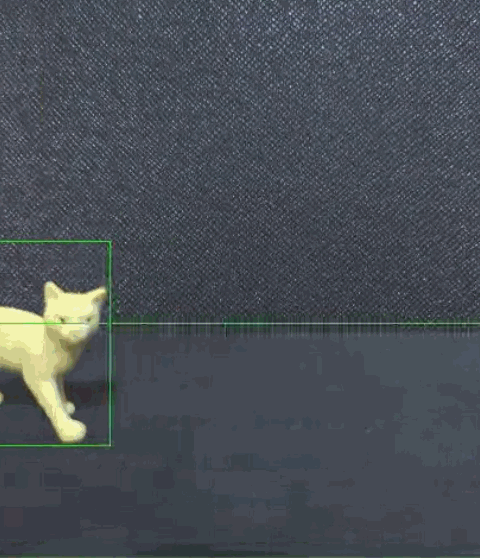 | 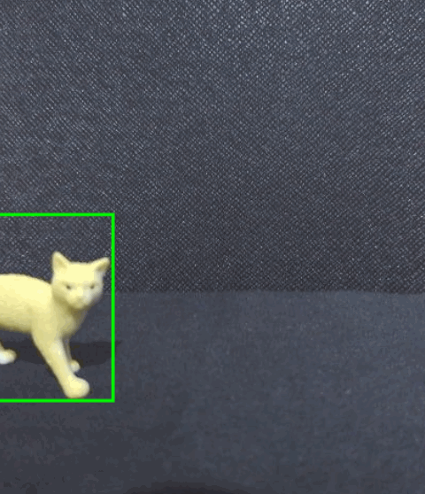 |
| WebRTC streaming | Custom WS stream |

#### WebRTC Streaming

The WebRTC visualization uses a `MediaStreamTrack`. This approach produces smoother video playback, but the annotations are rendered directly into the video frames and are subject to pixelation due to video encoding.

#### Custom WebSocket Streaming

The WebSocket visualization uses a custom stream where each transmitted message bundles the image with its corresponding metadata into a single byte stream. 

On the client side, the message is decoded and the image is rendered together with its annotations over a canvas. This allows the annotated data to be rendered with better quality.

## Camera Calibration

Stereo depth estimation requires the calculation of the intrinsic and extrinsic camera parameters to create rectification maps and projection matricies which are used by the application to rectify the input images and triangulate selected points.

- **Step 1:** Connect the binocular camera setup, select an image size (e.g. 640x480) and visualize the images on the application. 
> Make sure to stream in the correct order, camera 0 to the left and camera 1 to the right.

- **Step 2:** Take several photos of a [9x6 chessboard pattern](https://github.com/opencv/opencv/blob/4.x/doc/pattern.png). 
  - Make sure to cover the whole visible area of the cameras. 
  - Use the application's snapshot function to take the photos, resulting in stereo pairs.
  - Use different angles, orietations of the pattern as well as differnt close up distances.
  - Make sure the pattern on a completely flat surface. Folds or bumps will reduce the precision of the calibration.

These are examples of the images to take:
| | |
| :---: | :---: |
|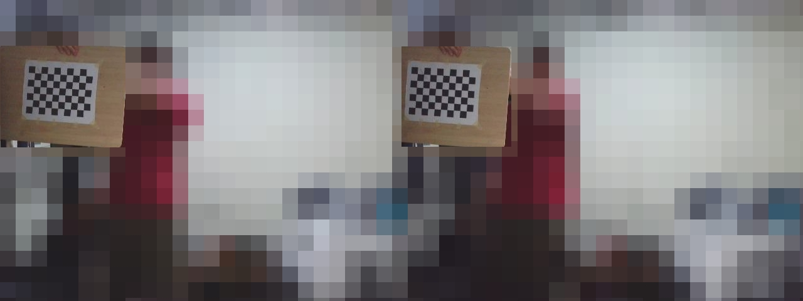 |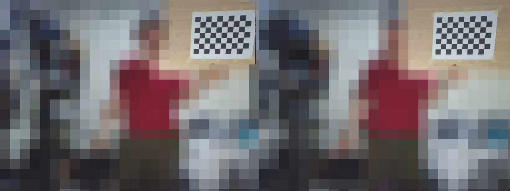 |
|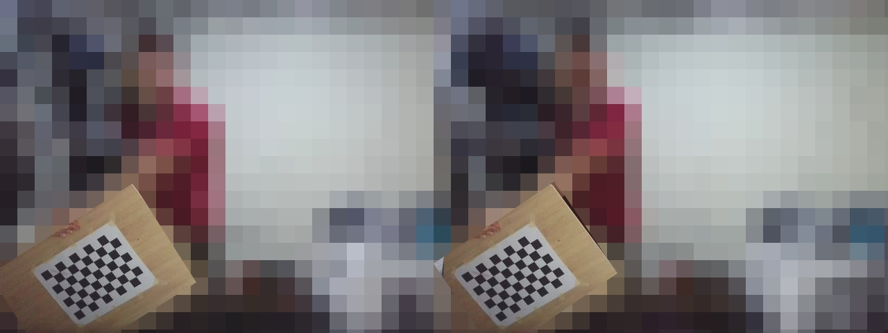 |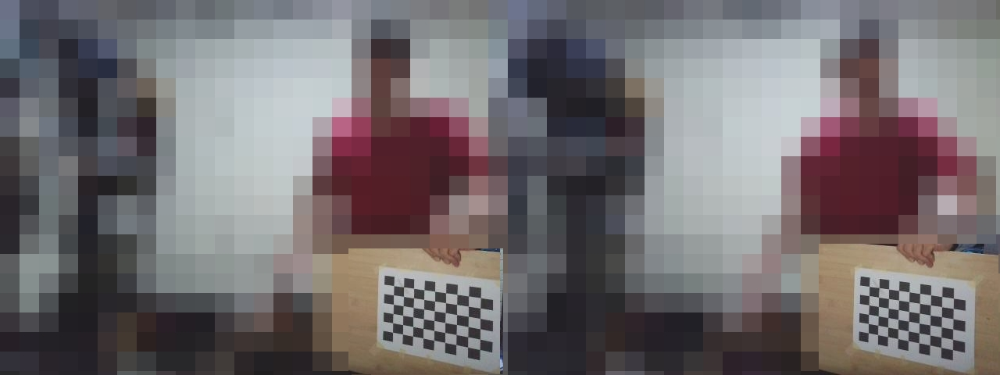 |

> **NOTE:** you can use a different pattern (See [this resource](https://markhedleyjones.com/projects/calibration-checkerboard-collection)). A good chessboard pattern is one that is not symmetrical, which makes the opencv functions take fewer guesses.

- **Step 3:** Create the calibration data using the [cam_calibration tool](./tools/cam_calibration/main.py) 
  - Make sure to update the `CHECKERBOARD_GRID_SIZE` and `CHECKERBOARD_SQUARE_LENGTH_MM` in the [cam_calibration tool](./tools/cam_calibration/main.py) to match the pattern you printed!!
  - Put the images in a directory, modify the directory path if necessary, and run the tool.
  - The tool will export the data as a `.pickle` file containing the following dictionary:

```json
{
  // RMS for the camera calibration and stereo calibration - in px
  "rms_cam_0": rms_cam_0, 
  "rms_cam_1": rms_cam_1, 
  "rms_stereo": rms_stereo, 
  // height and width of the input images - one side only
  "height_px": height, 
  "width_px": width,
  // distance between camera lenses in mm because the checkerboard is in mm
  "baseline_unit": "mm",
  "baseline_raw": baseline_raw, 
  "baseline_rect": baseline_rectified,
  // focal length of the camera setup
  "focal_length_unit": "px",
  "focal_length_x" : focal_x, 
  "focal_length_y" : focal_y, 
  // rotation and projection matrices for camera 0 and 1
  "R0": R0, 
  "R1": R1, 
  "P0": P0, 
  "P1": P1, 
  // rectification maps for camera 0 and 1
  "map_0_x": map_0_x, 
  "map_0_y": map_0_y, 
  "map_1_x": map_1_x, 
  "map_1_y": map_1_y 
  }
```

> **NOTE**: This data corresponds uniquely to the binocular camera setup and image size used for calibration. If the camera setup changes (e.g. cameras are separated a bit more) or the image size changes (e.g. different image shape: 640x480, 1080x720, etc.) then the calibration data must be created again for that specific configuration.

For a more in depth tutorial check [Temuge Batpurev's](https://temugeb.github.io/opencv/python/2021/02/02/stereo-camera-calibration-and-triangulation.html) post.

## Model Export and TensorRT Optimization

The YOLO object detection model is exported from its original PyTorch representation to a TensorRT engine using the Ultralytics export functionality.

Use the [yolo2trt tool](./tools/yolo2trt/main.py) to export a YOLO model to a TensorRT engine.

This will create a model with the following characteristics:
- `dynamic=True`: can run inference on different image sizes
- `batch=2`: can run inference on 1 or 2 images batched with NCHW layout
- `quantize=16`: the model is quantization presicion is set to 16-bit floating point. This reduces the model size and speeds up inference with negligible loss to precision.
- `nms=False`: creates an end-to-end model, which means the inference outputs the final detections as a tensor of shape `(N,300,6)` where `N` is the batch dimension (non-maximum suppression is done internally by the model). 

For more information read:
- [YOLO model export](https://docs.ultralytics.com/modes/export)
- [YOLO26 end-to-end model](https://docs.ultralytics.com/guides/end2end-detection)

## Performance Evaluation

Performance evaluation is an important part of this project, particularly because the implementation targets an embedded GPU platform.

### Methodology

The metrics were recorded with the `tegrastats` tool. The application wraps a process around the tool and consumes the output on every frame it processes. Each line of the tool stdout stream is a follows:

```log
11-03-2026 16:15:01 
RAM 4522/7546MB (lfb 2x4MB) SWAP 1/16384MB (cached 0MB) 
CPU [5%@729,6%@729,38%@729,3%@729,2%@729,6%@729] 
GR3D_FREQ 0% 
cpu@57.531C/57.593C soc2@57.593C/57.593C soc0@57C/57C gpu@57.531C/57.656C tj@57.781C/57.937C soc1@57.781C/57.937C 
VDD_IN 5585mW/5585mW/5585mW VDD_CPU_GPU_CV 1502mW/1489mW/1502mW VDD_SOC 1386mW/1386mW/1386mW
```
Where:
- The CPU usage percentage was calculated as the mean of the six CPU percentages, which are reported as `CPU [5%@729,6%@729,38%@729,3%@729,2%@729,6%@729]`
- The RAM usage is reported as a fraction in MB, `RAM 4522/7546MB`
- The GPU usage is reported as `GR3D_FREQ`
- The power consumption corresponds to the total average power consumed, which is reported as `VDD_IN lowest/average/peak`

### Results 

The following measurements were made for two separate executions, one using simple inference and another using optimized inference, by enabling the application's `Benchmarks` settings, under the following conditions:
- Sample of a 1000 binocular frames
- WebCam image 640x480 (width x height) at 30 fps
- Inference done with a dynamic YOLO model exported to TensorRT engine with batch=2

**Pipeline processing metrics:**

| Metric                | Simple inference | Optimized Inference |
|-----------------------|------------------|---------------------|
| GStremer frame grab   | 42.06 ± 9.98 ms  | 42.05 ± 13.84 ms    |
| Frame grab            | 1.36 ± 2.26  ms  | 16.08 ± 5.06  ms    |
| Stereo rectification  | 1.90 ± 0.75  ms  | 1.52 ± 0.74   ms    |
| Object detection      | 22.62 ± 2.91 ms  | 10.99 ± 4.74  ms    |
| Depth estimation      | 0.39 ± 0.44  ms  | 0.29 ± 0.27   ms    |

The total processing time does not include the GStreamer frame grab because this is an asynchronous operation to the actual pipeline processing.

| Metric                | Simple inference | Optimized Inference |
|-----------------------|------------------|---------------------|
| Total processing time | 26.27 ± 6.36 ms  | 28.88 ± 10.81 ms    |

**Resource usage metrics:**

| Metric                | Simple inference       | Optimized Inference  |
|-----------------------|------------------------|----------------------|
| CPU usage             | 17.041 ± 14.84 %       | 15.61 ± 14.26 %      |
| RAM usage             | 62.37  ±  0.24 %       | 62.31 ±  0.24 %      |
| GPU usage             | 60.50  ± 24.59 %       | 62.35 ± 23.60 %      |
| Power consumption     | 10600.05 ± 148.82 mW   | 10274.04 ± 390.35 mW |

### Discussion

The object detection is clearly faster using the optimized inference, however, the overall processing time for a single frame remains virtually the same because the frame grab stage takes longer. 

The main bottleneck is the webcams throughput. Because the webcams are configured to output frames at 30 fps, the GStreamer frame consumption remains virutally the same. 

Under the optimized inference run, the frame grab stage waits longer for a frame to be ready because the remaining stages take less time.

Resource usage remains virtually the same for both executions.


## Limitations and Future Improvements

Current limitations and potential areas for improvement include:

- **Depth accuracy:** Bounding box centers are only approximations of corresponding physical points. 

- **Object correspondence:** ByteTrack tracking to associate objects may produce incorrect matches, particularly when multiple similar objects are close together. A possible solution could be [DeepStream's Multi-View 3D Tracking](https://docs.nvidia.com/deepstream/text/DS_MV3DT).

- **Stereo camera synchronization:** Two independent USB webcams do not provide hardware-triggered synchronization. Better processing can be achieved with a hardware synchronized stereo camera.

- **USB webcam latency:** The webcams used have a USB 2.0 interface. An improvement could be to use a USB3.0 camera, which allows higher data transfer speeds.
